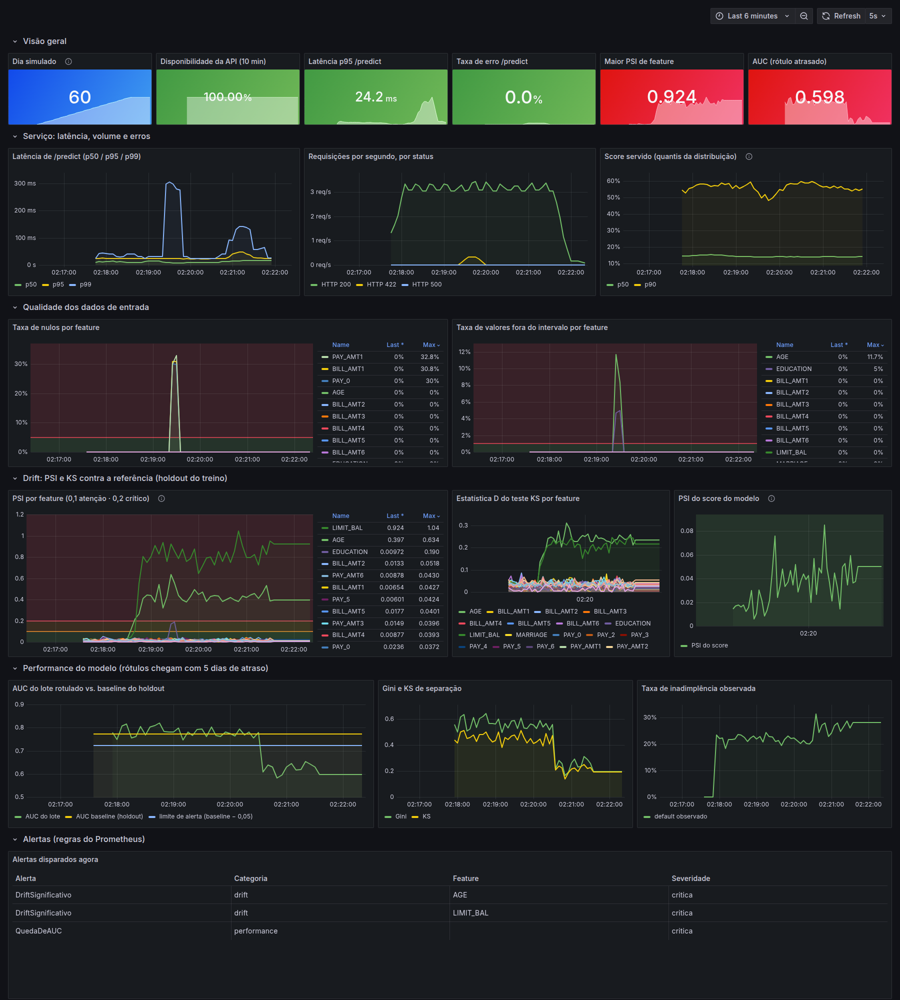
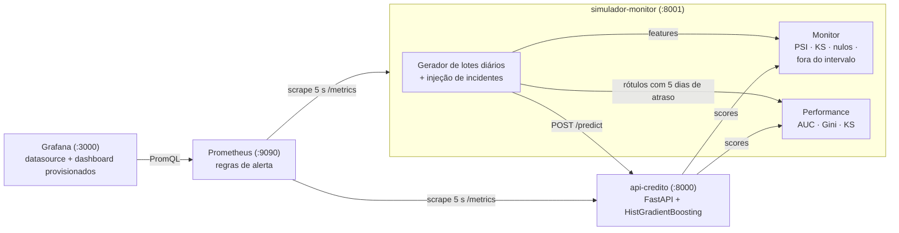

# Monitoramento de drift de um modelo de crédito em produção

[](https://github.com/Malik02/monitoramento-drift-modelo/actions/workflows/ci.yml)

Um modelo de risco de crédito servido por uma API, um simulador de produção que
**injeta problemas reais em dias conhecidos** e um monitor que pega cada um deles:
**drift de covariável**, **incidente de qualidade de dados** e **drift de conceito**.
Tudo exportado para **Prometheus**, visualizado num dashboard **Grafana provisionado
automaticamente** e coberto por **regras de alerta**. Sobe com um único `docker compose up`.



## O problema

Um modelo que tinha AUC 0,77 no dia do deploy não continua com AUC 0,77 sozinho.
Em produção, três coisas diferentes podem dar errado, e **cada uma exige um sinal
diferente**:

| O que acontece | Exemplo | Onde aparece | Quando aparece |
|---|---|---|---|
| A população muda (drift de covariável) | campanha nova traz clientes mais jovens e com limite maior | PSI / KS das features | no mesmo dia |
| O dado chega quebrado (qualidade) | mudança no pipeline upstream gera nulos e códigos inválidos | taxa de nulos / fora do intervalo | no mesmo dia |
| A relação X → y muda (drift de conceito) | choque econômico: bons pagadores passam a atrasar | **só** na performance com rótulo | dias (na vida real, meses) depois |

O ponto central da demo: **o drift de conceito é invisível para o PSI**. As features e
o score continuam com a mesma distribuição; só a AUC medida com o rótulo atrasado
revela que o modelo parou de separar bons e maus pagadores. E o contrário também vale:
o drift de covariável dispara PSI > 0,8, mas a AUC continua em ~0,78. **Alerta de
PSI não significa modelo quebrado**, significa "vá investigar".

## Arquitetura



| Componente | Arquivo | Papel |
|---|---|---|
| Dados | `src/monitoramento/dados.py` | baixa o dataset da UCI e divide em treino (60%), referência/holdout (20%) e pool de produção (20%), estratificado, semente 42 |
| Modelo | `src/monitoramento/treino.py` | `HistGradientBoostingClassifier` com semente fixa; salva modelo e metadados |
| API | `src/monitoramento/api.py` | `POST /predict`, `GET /health`, `GET /metrics` (contagem de requisições, erros, histograma de latência, distribuição do score, nulos recebidos) |
| Estatísticas | `src/monitoramento/estatisticas.py` | **PSI implementado à mão**, teste KS, AUC / Gini / KS de separação |
| Qualidade | `src/monitoramento/qualidade.py` | taxa de nulos e de valores fora da faixa de domínio por feature |
| Incidentes | `src/monitoramento/incidentes.py` | os três problemas injetados, cada um numa função pura e testada |
| Monitor | `src/monitoramento/monitor.py` | calcula tudo por lote e exporta como gauges Prometheus |
| Simulador | `src/monitoramento/simulador.py` | linha do tempo de 60 dias, envia à API, entrega os rótulos com atraso |
| Infra | `docker-compose.yml`, `docker/`, `infra/` | imagem única, Prometheus com alertas, Grafana provisionado |
| Dashboard | `scripts/gerar_dashboard.py` | gera o JSON do dashboard (dashboard como código) |

## Como rodar

Pré-requisitos: Docker com Docker Compose v2. O build baixa o dataset público
(~5 MB da UCI) e treina o modelo dentro da imagem, então precisa de internet.

```bash
git clone https://github.com/Malik02/monitoramento-drift-modelo.git
cd monitoramento-drift-modelo
docker compose up -d --build      # ~2-3 min no primeiro build
docker compose logs -f simulador  # acompanhe os dias passando
```

| Serviço | URL | Observação |
|---|---|---|
| Grafana | <http://localhost:3000> | abre direto no dashboard; acesso anônimo de leitura. Login de admin: `admin` / `admin` |
| Prometheus | <http://localhost:9090> | veja <http://localhost:9090/alerts> durante a simulação |
| API | <http://localhost:8000/docs> | Swagger da API; métricas em `/metrics` |
| Monitor | <http://localhost:8001/metrics> | métricas de drift, qualidade e performance |

A simulação inteira (60 dias × 4 s) leva **cerca de 4 minutos**. Ao terminar, o
simulador continua de pé expondo os últimos valores. Para repetir:
`docker compose restart simulador`. Para encerrar: `docker compose down`.

Para deixar a demo mais lenta ou mais rápida: `SEGUNDOS_POR_DIA=8 docker compose up -d`.

### Sem Docker (desenvolvimento)

```bash
python3.12 -m venv .venv && source .venv/bin/activate
pip install -r requirements-dev.txt && pip install -e .
python -m monitoramento.treino                      # baixa dados e treina
python -m monitoramento.simulador --offline --saida docs/linha_do_tempo.csv
pytest && ruff check .
```

O modo `--offline` roda a linha do tempo inteira em segundos, sem API nem Prometheus,
e grava o resultado por dia em CSV ([`docs/linha_do_tempo.csv`](docs/linha_do_tempo.csv)).

## O que a demo mostra (linha do tempo)

Cada dia simulado = 600 clientes sorteados do pool de produção, enviados em 12
requisições de 50. Os rótulos de um dia chegam **5 dias depois** (em crédito real,
a inadimplência leva de 30 a 90 dias para ser observada).

| Dia | Evento injetado | Sinal esperado | Valores observados (semente 42) |
|---|---|---|---|
| 1-14 | operação normal | tudo verde | PSI máx. 0,02-0,05; AUC diária 0,75-0,82 |
| 15-19 | **drift de covariável** em rampa: `LIMIT_BAL` até +50% e `AGE` até −5 anos | PSI cruza 0,1 e depois 0,2 | AGE: 0,08 → 0,12 → 0,22; LIMIT_BAL chega a ~0,8 no dia 19 |
| 20-39 | drift de covariável estável | PSI alto, **AUC continua normal** | PSI LIMIT_BAL 0,64-0,93; AUC 0,75-0,80 |
| 28-30 | **incidente de qualidade**: 30% de nulos em `PAY_0`, `BILL_AMT1`, `PAY_AMT1`; 10% `AGE = -1`; 5% `EDUCATION = 99`; 3 requisições malformadas/dia | nulos e fora do intervalo disparam; erros HTTP 422 | nulos máx. 31-33%; fora do intervalo máx. 8-12% |
| 40+ | **drift de conceito**: 12% dos clientes em dia passam a inadimplir, 35% dos atrasados se recuperam | **nada muda no PSI**; a AUC cai quando os rótulos chegam (dia 45) | PSI do score continua < 0,1; AUC 0,58-0,65 |

## PSI: fórmula, limiares e por quê

Com faixas (bins) definidas **na distribuição de referência** e `r_i`, `a_i` as
proporções de referência e do lote atual na faixa *i*:

$$PSI = \sum_i (a_i - r_i)\,\ln\left(\frac{a_i}{r_i}\right)$$

Implementação: [`estatisticas.py`](src/monitoramento/estatisticas.py).

- **Faixas**: decis da referência para variáveis contínuas; uma faixa por valor para
  variáveis discretas (até 12 valores distintos, ex.: `PAY_0`, `EDUCATION`). As bordas
  externas são −∞ e +∞, então um valor novo nunca "cai fora" do histograma.
- **Faixas fixas**: calculadas uma vez na referência, nunca no lote atual; senão o
  próprio drift moveria as bordas e o esconderia.
- **Faixa vazia**: as proporções têm piso de 10⁻⁴ para evitar `ln(0)`.
- **Nulos** ficam fora do PSI e são medidos à parte na taxa de nulos. Misturar os
  dois esconderia a causa do alerta.
- **Por que funciona**: cada termo é ≥ 0 (os dois fatores sempre têm o mesmo sinal).
  O PSI é a divergência de KL simétrica (de Jeffreys): `KL(a‖r) + KL(r‖a)`. Para duas
  normais de mesma variância, isso dá `Δμ²/σ²`; o teste
  `test_psi_normal_deslocada_aproxima_divergencia_de_jeffreys` confere que N(0,1) vs
  N(0,5;1) dá PSI ≈ 0,22, um pouco abaixo do valor contínuo de 0,25 por causa da
  discretização.

**Limiares (convenção de mercado em crédito)**:

| PSI | Leitura | Ação |
|---|---|---|
| < 0,1 | estável | nada |
| 0,1 a 0,2 | mudança moderada | alerta de aviso, acompanhar |
| ≥ 0,2 | mudança significativa | alerta crítico: investigar origem, avaliar retreino |

São limiares empíricos, não testes de hipótese: o PSI não depende do tamanho da
amostra da mesma forma que o p-valor do KS. Com 600 clientes por dia, o KS fica
"significativo" com mudanças pequenas, sem importância para o negócio. Por isso o
PSI decide o alerta, e o KS (estatística D) fica no painel como sinal complementar.

> Observação: `LIMIT_BAL` é sempre múltiplo de 10 mil no dataset, então muitos
> clientes ficam exatamente nas bordas dos decis. Um aumento de 50% desloca essas
> massas inteiras de faixa, e o PSI chega a ~0,8 (acima do que uma distribuição
> contínua com o mesmo deslocamento daria). Variáveis com valores "redondos" costumam
> ser as mais sensíveis ao PSI.

## Alertas provisionados

Regras em [`infra/prometheus/alertas.yml`](infra/prometheus/alertas.yml), carregadas
pelo Prometheus e visíveis também em *Alerting → Alert rules* no Grafana
(datasource com `manageAlerts: true`). Os `for:` são curtos porque o tempo está
comprimido.

| Alerta | Regra | Severidade |
|---|---|---|
| `ApiIndisponivel` | `up{job="api-credito"} == 0` por 15 s | crítica |
| `TaxaDeErroAlta` | erros/requisições em `/predict` > 5% | crítica |
| `LatenciaP95Alta` | p95 de `/predict` > 250 ms por 30 s | alerta |
| `TaxaDeNulosAlta` | `monitor_taxa_nulos > 0.05` | crítica |
| `ValoresForaDoIntervalo` | `monitor_taxa_fora_intervalo > 0.01` | crítica |
| `DriftModerado` | `0.1 < monitor_psi <= 0.2` | aviso |
| `DriftSignificativo` | `monitor_psi > 0.2` por 10 s | crítica |
| `DriftNoScore` | `monitor_psi_score > 0.2` por 10 s | crítica |
| `QuedaDeAUC` | média móvel de ~5 dias da AUC < baseline − 0,05 | crítica |

A AUC diária com 600 clientes oscila ±0,03 só por amostragem (no regime normal
houve dia com 0,71). Por isso o alerta de AUC usa média móvel: um único dia ruim
não acorda ninguém de madrugada.

## Decisões de projeto

| Decisão | Alternativa | Por quê |
|---|---|---|
| PSI e métricas implementados à mão | Evidently / NannyML | o objetivo é saber explicar cada número; as bibliotecas são ótimas em produção, mas escondem as escolhas (faixas, piso, nulos) |
| `HistGradientBoostingClassifier` | regressão logística, XGBoost | trata nulos nativamente (a API não cai no incidente; quem avisa é o monitor), rápido, sem dependência extra |
| Nulos aceitos na API | rejeitar com 422 | rejeitar derruba a jornada do cliente; aceitar e alertar é o comportamento comum em crédito. Payload malformado (tipo errado) continua virando 422 |
| Referência = holdout do treino | o próprio treino | o score no treino é otimista (overfit); o holdout representa o que o modelo "viu" de forma honesta |
| Rótulo atrasado explícito | performance imediata | é a realidade de crédito, e é por isso que o drift de conceito demora a aparecer |
| Alertas no Prometheus | Grafana Alerting | regras versionadas em YAML, validáveis com `promtool`, independentes da UI |
| Imagem única para API e simulador | duas imagens | um build só, mesmo modelo e mesmos dados garantidos nos dois lados |
| Modelo treinado no `docker build` | modelo versionado no git | nada binário no repositório, e o build prova que o treino é reproduzível (AUC 0,7733 local e na imagem) |
| Dashboard gerado por script | JSON editado na UI | dashboard como código: revisável em PR, sem cliques manuais |

## Resultados

- **Modelo** (holdout de 6.000 clientes): AUC **0,773**, Gini **0,547**, KS **0,418**.
- **Drift de covariável**: PSI de `AGE` vai de ~0,02 a 0,22 no dia 17 (terceiro dia da
  rampa) e se estabiliza em 0,3-0,6; `LIMIT_BAL` passa de 0,8. A AUC **não cai**.
- **Qualidade**: nulos saltam de 0% para ~31% nos dias 28-30 e voltam a 0% no dia 31.
- **Drift de conceito**: o PSI do score fica abaixo de 0,1 o tempo todo (máx. 0,085), mas a AUC
  cai de ~0,78 (média dos dias 1-39) para ~0,62 (dias 40-55) quando os rótulos chegam.

### Alertas que dispararam numa execução real (`docker compose up`)

| Alerta | Dia simulado aproximado | Duração |
|---|---|---|
| `DriftModerado` (AGE, LIMIT_BAL) | 16-17 | passageiro, até o PSI cruzar 0,2 |
| `DriftSignificativo` (AGE, LIMIT_BAL) | 19 em diante | até o fim (a população nova é permanente) |
| `TaxaDeNulosAlta` (PAY_0, BILL_AMT1, PAY_AMT1) | 28-30 | some quando o incidente acaba |
| `ValoresForaDoIntervalo` (AGE, EDUCATION) | 28-30 | idem |
| `DriftModerado` (EDUCATION) | 28-30 | o código 99 também desloca a distribuição |
| `TaxaDeErroAlta` | 30-31 | 9 requisições 422 em 729 no total |
| `QuedaDeAUC` | ~48 (rótulos do dia ~43) | até o fim |

Não dispararam (como esperado): `ApiIndisponivel` (disponibilidade 100%),
`LatenciaP95Alta` (p95 de ~25 ms) e `DriftNoScore`.

Screenshot: `CHROME=/caminho/do/chrome scripts/capturar_dashboard.sh` (Chromium headless, com a stack no ar).

## Testes e CI

```bash
pytest        # 31 testes, sem rede (dados sintéticos com o mesmo esquema)
ruff check .
```

Cobrem: PSI calculado à mão contra valores conhecidos, simetria, PSI ≈ divergência de
Jeffreys em normais deslocadas, nulos, categorias novas; checagens de qualidade;
cada incidente; uma simulação curta que verifica os três sinais; e a API com
`TestClient` (predição, nulos, 422 contado como erro, formato do `/metrics`).
O GitHub Actions roda `ruff` + `pytest` a cada push ([`ci.yml`](.github/workflows/ci.yml)).

## Limitações

- O monitor recebe o lote direto do simulador. Em produção, ele leria as
  requisições de um log ou feature store, e os rótulos de um data warehouse.
- O pool de produção é o próprio dataset da UCI (Taiwan, 2005). O drift é injetado,
  não observado; a força de cada incidente foi escolhida para ser visível na demo.
- Os gauges guardam só o último lote. O Prometheus vira o histórico; para auditoria
  de longo prazo, os resultados por dia deveriam ir para uma tabela (o CSV do modo
  offline é um esboço disso).
- O PSI por feature é univariado: não detecta mudança na correlação entre features.
- Os alertas não têm Alertmanager (sem roteamento para Slack, PagerDuty etc.).
- A latência medida é a do processo da API; não há injeção de lentidão nem de
  indisponibilidade na demo (os alertas de serviço existem, mas ficam verdes).
- Grafana com senha padrão e acesso anônimo de leitura: adequado só para demo local.

## Próximos passos

- [ ] Alertmanager com rota para Slack e silenciamento por janela de manutenção
- [ ] Drift multivariado (classificador de domínio referência vs. produção)
- [ ] Gatilho de retreino (champion/challenger) quando `QuedaDeAUC` persistir
- [ ] Persistir as métricas por lote em banco (Postgres) para auditoria
- [ ] Teste de carga da API (Locust) para calibrar o alerta de latência
- [ ] Monitorar fairness (taxa de aprovação por `SEX` e faixa de `AGE`)

## Dados

*Default of Credit Card Clients*, Yeh, I. C. & Lien, C. H. (2009), UCI Machine
Learning Repository, [doi:10.24432/C55S3H](https://doi.org/10.24432/C55S3H), licença
CC BY 4.0. 30.000 clientes de cartão de crédito em Taiwan, alvo: inadimplência no
mês seguinte (22,1%). O download é feito pelo código; os dados não são versionados.

---

Autor: **Abdul Malik de Barros** · [LinkedIn](https://www.linkedin.com/in/abdul-malik-de-barros-a51b71190/)
